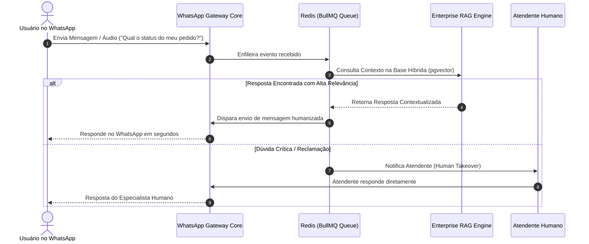

# 💬 Enterprise WhatsApp AI Gateway & RAG Connector (Node.js)

<p align="center">
  
</p>

<p align="center">
  <strong>Production-ready, self-hosted WhatsApp API Gateway & Conversational RAG Connector engineered with Node.js, NestJS / Fastify, TypeScript, Baileys, Redis BullMQ, and PostgreSQL.</strong>
</p>

<p align="center">
  <a href="#-architecture--conversational-flow"></a>
  <a href="#-key-features"></a>
  <a href="LICENSE"></a>
</p>

<p align="center">
  
  
  
  
  
  
  
</p>

---

## 📌 Visão Geral & Proposta de Valor

O **Enterprise WhatsApp AI Gateway** é uma infraestrutura completa, open-source e auto-hospedada (self-hosted) para integração do **WhatsApp com motores de Inteligência Artificial Generativa, RAG Híbrido e Agentes Autônomos**.

Elimina custos de APIs de terceiros e limites abusivos de provedores SaaS, fornecendo **multi-sessões simultâneas via QR Code**, envio assíncrono blindado contra bloqueios com **Redis & BullMQ**, transcrição de áudios com **Whisper** e respostas corporativas em tempo real conectadas ao **PostgreSQL + pgvector**.

---

## 🏛️ Arquitetura do Sistema & Fluxo Conversacional

```text
+---------------------------------------------------------------------------------------------------------+
|                                    WHATSAPP NETWORK & END CLIENTS                                       |
+---------------------------------------------------------------------------------------------------------+
                                                     │
                                                     │ Real-time WhatsApp Protocol (Baileys Engine)
                                                     ▼
+---------------------------------------------------------------------------------------------------------+
|                               ENTERPRISE WHATSAPP AI GATEWAY (Node.js)                                  |
|                                                                                                         |
|   • Multi-Session Manager (QR Code)  • Webhook Inbound Dispatcher  • Security & Anti-Throttle Limiter   |
+---------------------------------------------------------------------------------------------------------+
                                                     │
                                                     │ Ingest Message Event
                                                     ▼
+---------------------------------------------------------------------------------------------------------+
|                                     REDIS BULLMQ ASYNC OUTBOX & INBOX                                   |
|                                                                                                         |
|   • Priority Inbound Queue      • Outbox Anti-Ban Scheduler       • Message Retry & Dead-Letter         |
+---------------------------------------------------------------------------------------------------------+
                                                     │
                                                     ▼
+---------------------------------------------------------------------------------------------------------+
|                                 INTELLIGENT AI & RAG ROUTING LAYER                                      |
|                                                                                                         |
|   1. Audio Voice Note ───► Whisper Audio Transcriber ───► Text Normalized                               |
|   2. User Text Query  ───► Enterprise RAG Node (Hybrid Search pgvector + BM25)                          |
|   3. Complex Actions  ───► Multi-Agent Orchestrator Node (Supervisor & Researcher)                      |
|   4. Human Escalation ───► Live Human Takeover Webhook                                                  |
+---------------------------------------------------------------------------------------------------------+
                                                     │
                                                     │ Contextual AI Response
                                                     ▼
+---------------------------------------------------------------------------------------------------------+
|                                  OUTBOX DISPATCHER (Baileys Outbound)                                   |
|                Envia mensagens de texto, áudios e documentos de volta para o cliente                    |
+---------------------------------------------------------------------------------------------------------+
```

---

## 🤖 Capacidades & Módulos

| Módulo | Tecnologia | Responsabilidade |
|---|---|---|
| **Session Core** | `Baileys / Multi-Device` | Gerenciamento de QR Code, reconexão automática e persistência de sessões. |
| **Outbox Queue** | `Redis / BullMQ` | Agendamento de envios com delay humanizado para evitar banimentos. |
| **RAG Connector** | `Fastify / REST API` | Conexão com o motor `OPENSOUNCER-RAG` para respostas com dados de PDFs/DOCX. |
| **Media Engine** | `FFmpeg + Audio Parser` | Transcrição de áudio recebido e compressão de mídias enviadas. |
| **Human Takeover** | `WebSockets + Webhook` | Pausa no bot para intervenção imediata de atendente humano. |

---

## 🧠 Diagrama de Sequência (Atendimento Inteligente com RAG)



---

## 🛠️ Tech Stack & Dependências

- **Runtime**: Node.js 20+ & TypeScript 5.x
- **WhatsApp Engine**: `@whiskeysockets/baileys`
- **Fila & Agendamento**: Redis 7 + BullMQ
- **Armazenamento**: PostgreSQL 16 / SQLite Multi-Session Storage
- **Conexão de IA**: OpenAI / Ollama Local / Enterprise RAG Engine
- **Testes & CI/CD**: Vitest / Jest + GitHub Actions

---

## ⚙️ Quickstart & Instalação

```bash
# 1. Clonar e Instalar Dependências
git clone https://github.com/dev-rodrigues00/OPENSOUNCER-whatsapp-ai-node.git
cd OPENSOUNCER-whatsapp-ai-node
npm install

# 2. Configurar Variáveis de Ambiente
cp .env.example .env

# 3. Subir Infraestrutura e Iniciar
docker compose up -d
npm run start:dev
```

---

## 🛡️ Licença

Distribuído sob a licença **MIT Open Source**. Consulte o arquivo [LICENSE](LICENSE) para mais detalhes.

---

<p align="center">
  <sub>Desenvolvido por <strong>Dev Rodrigues</strong> • Enterprise Conversational AI & WhatsApp Gateway 2026. 🚀</sub>
</p>
